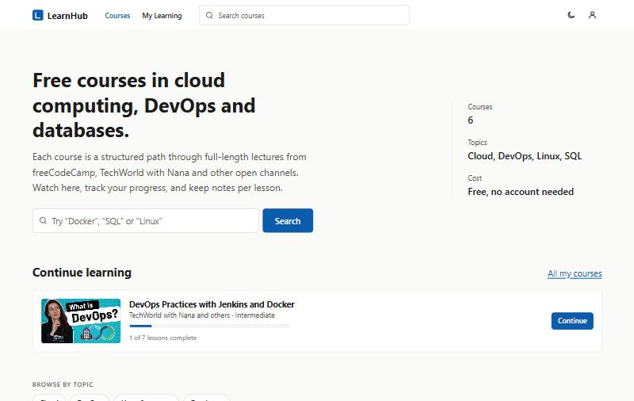
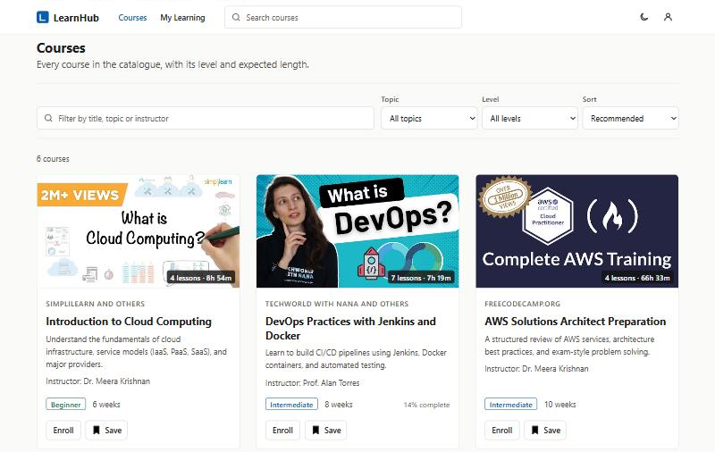
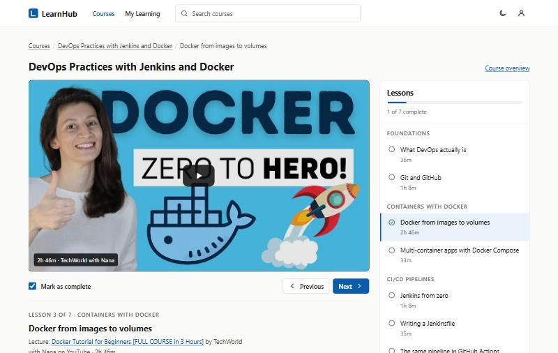
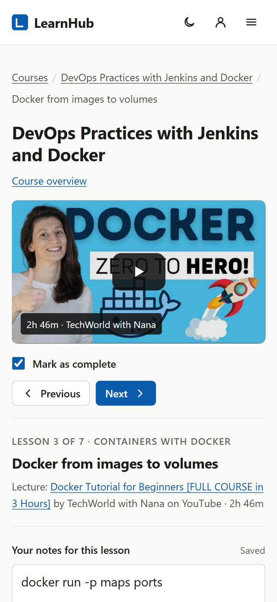

# LearnHub – Online Education Platform

A small online learning platform built with **Python Flask**, **Jinja2 templates**, **SQLite** and plain **HTML, CSS and JavaScript** (no build step). Each course is a structured path through free, full-length lectures on YouTube. Created as a Cloud Computing course project: the app is Dockerised and built by a Jenkins CI/CD pipeline.



---

## Features

| Page | Route | What it does |
|---|---|---|
| Home and catalogue | `/` | Short intro, topic links, "How it works", and every course as a card with its YouTube thumbnail. Search, filter by topic and level, and sort, all in the browser. Accepts `?q=`, `?category=` and `?level=`. |
| Course | `/course/<id>` | Description, what you'll learn, syllabus by module, prerequisites, video credits, and Enroll. |
| Lesson player | `/course/<id>?lesson=<lessonId>` | The video on the left and the lesson list on the right (stacked on phones). Previous/Next, mark as complete, and notes per lesson. |
| Enroll | `/enroll/<id>` | Enrollment form with validation, stored in SQLite. |
| My Learning | `/my-enrollments` | Courses in progress with a progress bar and Continue, saved courses, and your enrollments looked up by email. |
| Health check | `/health` | Returns `{"status": "healthy"}` for load balancers and CI probes. |

Kept in the browser (`localStorage`, nothing is sent to the server):

- lesson progress and "continue where you left off"
- courses saved for later
- notes for each lesson, saved as you type
- light or dark theme (follows the system setting until you choose one)

Videos use a click-to-load facade: the page shows the thumbnail, and the `youtube-nocookie.com` player loads only when you press play.

### Screenshots

| | Desktop | Phone |
|---|---|---|
| Home |  |  |
| Catalogue |  | |
| Player |  |  |

---

## Folder Structure

```
├── app.py                  # Flask application (routes, config)
├── database.py             # SQLite helpers (schema, seed data)
├── requirements.txt        # Python dependencies
├── requirements-dev.txt    # Test dependencies (pytest)
├── Dockerfile              # Container image definition
├── Jenkinsfile             # CI pipeline: install, test, build image
├── tests/                  # pytest suite
├── templates/
│   ├── base.html           #   Layout: header, search, mobile menu, footer
│   ├── home.html           #   Home and catalogue
│   ├── course_detail.html  #   Course overview and lesson player
│   ├── enroll.html         #   Enrollment form
│   └── my_enrollments.html #   My Learning
├── static/
│   ├── css/main.css        #   Design tokens, layout and components
│   ├── js/app.js           #   Catalogue filters, player, progress, notes, theme
│   └── data/courses.json   #   Modules, lessons and YouTube IDs for each course
└── docs/screenshots/       # README images
```

### Course content

Course rows (title, instructor, level, duration) live in SQLite, as before. The lessons and videos for each course live in `static/data/courses.json`, matched to the database by course `id`, so no schema change was needed. Each lesson looks like this:

```json
{ "id": "2-3", "title": "Docker from images to volumes", "youtubeId": "3c-iBn73dDE",
  "seconds": 9975, "duration": "2h 46m", "channel": "TechWorld with Nana",
  "sourceTitle": "Docker Tutorial for Beginners [FULL COURSE in 3 Hours]",
  "sourceUrl": "https://www.youtube.com/watch?v=3c-iBn73dDE" }
```

To add a lesson, add an entry to the course's module in that file. Every video ID was checked against YouTube's oEmbed endpoint.

---

## Running Locally

You need Python 3.10 or newer.

```bash
python -m venv venv
# Windows (PowerShell):
.\venv\Scripts\Activate.ps1
# macOS / Linux:
source venv/bin/activate

pip install -r requirements.txt
python app.py
```

The app starts on **http://localhost:5000**. The SQLite database (`learnhub.db`) is created on first run with the sample courses. An internet connection is needed for thumbnails and videos.

Run the tests:

```bash
pip install -r requirements-dev.txt
python -m pytest tests/ -v
```

### Environment Variables (optional)

| Variable | Default | Purpose |
|---|---|---|
| `SECRET_KEY` | `dev-secret-change-in-production` | Flask session secret |
| `DATABASE_PATH` | `learnhub.db` | Path to the SQLite file |
| `PORT` | `5000` | Port the server listens on |
| `FLASK_DEBUG` | `0` | Set to `1` for auto-reload during development |

---

## Running with Docker

```bash
docker build -t learnhub .
docker run -p 5000:5000 learnhub
```

Then open **http://localhost:5000**.

---

## Video credits

All lectures are free videos published on YouTube by their creators. LearnHub only embeds them, and each lesson links back to the original. Instructor names on course pages are the course project's sample data.

**Introduction to Cloud Computing**

- [Cloud Computing In 6 Minutes | What Is Cloud Computing?](https://www.youtube.com/watch?v=M988_fsOSWo) by Simplilearn
- [AWS Certified Cloud Practitioner Training 2020 - Full Course](https://www.youtube.com/watch?v=3hLmDS179YE) by freeCodeCamp.org
- [Microsoft Azure Fundamentals Certification Course (AZ-900)](https://www.youtube.com/watch?v=NKEFWyqJ5XA) by freeCodeCamp.org
- [Learn Terraform (and AWS) by Building a Dev Environment](https://www.youtube.com/watch?v=iRaai1IBlB0) by freeCodeCamp.org

**DevOps Practices with Jenkins and Docker**

- [What is DevOps? REALLY understand it | DevOps vs SRE](https://www.youtube.com/watch?v=0yWAtQ6wYNM) by TechWorld with Nana
- [Git and GitHub for Beginners - Crash Course](https://www.youtube.com/watch?v=RGOj5yH7evk) by freeCodeCamp.org
- [Docker Tutorial for Beginners [FULL COURSE in 3 Hours]](https://www.youtube.com/watch?v=3c-iBn73dDE) by TechWorld with Nana
- [Docker Compose Tutorial](https://www.youtube.com/watch?v=HG6yIjZapSA) by Programming with Mosh
- [Learn Jenkins! Complete Jenkins Course - Zero to Hero](https://www.youtube.com/watch?v=6YZvp2GwT0A) by DevOps Journey
- [Complete Jenkins Pipeline Tutorial | Jenkinsfile explained](https://www.youtube.com/watch?v=7KCS70sCoK0) by TechWorld with Nana
- [GitHub Actions Tutorial - Basic Concepts and CI/CD Pipeline with Docker](https://www.youtube.com/watch?v=R8_veQiYBjI) by TechWorld with Nana

**AWS Solutions Architect Preparation**

- [AWS Certified Cloud Practitioner Training 2020 - Full Course](https://www.youtube.com/watch?v=3hLmDS179YE) by freeCodeCamp.org
- [AWS Certified Solutions Architect - Associate 2020 (PASS THE EXAM!)](https://www.youtube.com/watch?v=Ia-UEYYR44s) by freeCodeCamp.org
- [AWS Solutions Architect Associate Certification (SAA-C03) – Full Course to PASS the Exam](https://www.youtube.com/watch?v=c3Cn4xYfxJY) by freeCodeCamp.org
- [Learn Terraform (and AWS) by Building a Dev Environment](https://www.youtube.com/watch?v=iRaai1IBlB0) by freeCodeCamp.org

**Linux System Administration Essentials**

- [Linux Operating System - Crash Course for Beginners](https://www.youtube.com/watch?v=ROjZy1WbCIA) by freeCodeCamp.org
- [The 50 Most Popular Linux & Terminal Commands - Full Course for Beginners](https://www.youtube.com/watch?v=ZtqBQ68cfJc) by freeCodeCamp.org
- [Introduction to Linux – Full Course for Beginners](https://www.youtube.com/watch?v=sWbUDq4S6Y8) by freeCodeCamp.org
- [Bash Scripting Tutorial for Beginners](https://www.youtube.com/watch?v=tK9Oc6AEnR4) by freeCodeCamp.org

**Containerisation and Kubernetes**

- [What is Kubernetes | Kubernetes explained in 15 mins](https://www.youtube.com/watch?v=VnvRFRk_51k) by TechWorld with Nana
- [Kubernetes Crash Course for Absolute Beginners [NEW]](https://www.youtube.com/watch?v=s_o8dwzRlu4) by TechWorld with Nana
- [Kubernetes Tutorial for Beginners [FULL COURSE in 4 Hours]](https://www.youtube.com/watch?v=X48VuDVv0do) by TechWorld with Nana
- [Docker Containers and Kubernetes Fundamentals – Full Hands-On Course](https://www.youtube.com/watch?v=kTp5xUtcalw) by freeCodeCamp.org
- [How Prometheus Monitoring works | Prometheus Architecture explained](https://www.youtube.com/watch?v=h4Sl21AKiDg) by TechWorld with Nana

**Database Design and SQL Fundamentals**

- [SQL Tutorial - Full Database Course for Beginners](https://www.youtube.com/watch?v=HXV3zeQKqGY) by freeCodeCamp.org
- [SQL Course for Beginners [Full Course]](https://www.youtube.com/watch?v=7S_tz1z_5bA) by Programming with Mosh
- [Database Design Course - Learn how to design and plan a database for beginners](https://www.youtube.com/watch?v=ztHopE5Wnpc) by freeCodeCamp.org
- [Learn PostgreSQL Tutorial - Full Course for Beginners](https://www.youtube.com/watch?v=qw--VYLpxG4) by freeCodeCamp.org

---

## Not Included Yet

- **User accounts.** Enrollment is looked up by email, and progress, notes and saved courses stay in the browser.
- **Saving progress in the database.** This would need new tables and API routes.
- **AWS deployment.** This will be added separately as the CD part of the course project.

---

## License

The code is for educational purposes as part of a Cloud Computing course. The videos belong to their creators.
