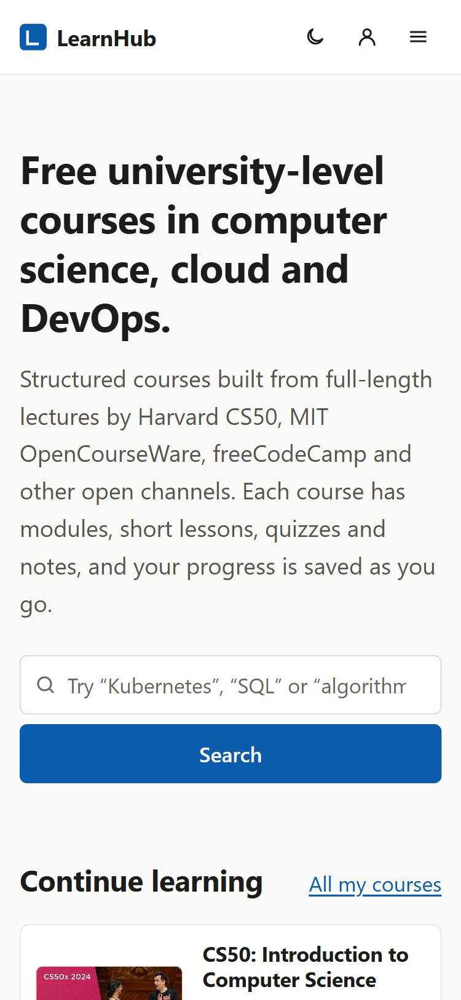
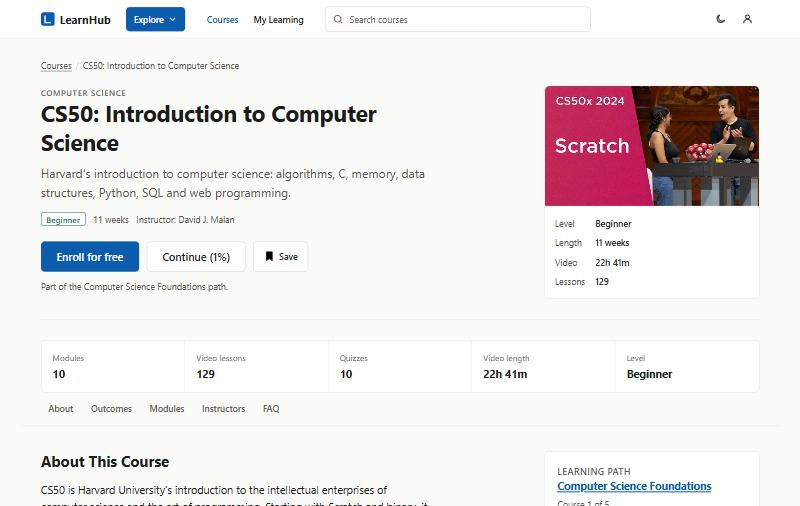

# LearnHub – Online Education Platform

A small online learning platform built with **Python Flask**, **Jinja2 templates**, **SQLite** and plain **HTML, CSS and JavaScript** (no build step). It has 20 courses with 988 video lessons and 62 module quizzes, built from 70 free lectures by Harvard CS50, MIT OpenCourseWare, freeCodeCamp and other channels on YouTube. Created as a Cloud Computing course project: the app is Dockerised and built by a Jenkins CI/CD pipeline.


---

## Features

| Page | Route | What it does |
|---|---|---|
| Home and catalogue | `/` | Intro, continue learning, learning paths, topics, and every course as a card. A filter sidebar (topic, level, video length), search and sort, all in the browser. Accepts `?q=`, `?category=`, `?level=`, `?length=` and `?path=`. |
| Course | `/course/<id>` | Key facts, skills you'll gain, what you'll learn, the syllabus by module (with module descriptions, lessons and a quiz), instructors and channels, FAQ, learning paths and related courses. |
| Lesson player | `/course/<id>?lesson=<lessonId>` | The video on the left and the course content on the right (stacked on phones). Previous/Next, mark as complete, and notes per lesson. Long lectures are split at the creator's own chapter marks, and each lesson plays just its part. |
| Module quiz | `/course/<id>?lesson=m<N>-quiz` | Multiple-choice questions with explanations, scored in the browser. Passing (70%) marks the quiz complete. |
| Enroll | `/enroll/<id>` | Enrollment form with validation, stored in SQLite. |
| My Learning | `/my-enrollments` | Courses in progress with a progress bar and Continue, saved courses, and your enrollments looked up by email. |
| Health check | `/health` | Returns `{"status": "healthy"}` for load balancers and CI probes. |

The header has an **Explore** menu with every topic and learning path.

Kept in the browser (`localStorage`, nothing is sent to the server):

- lesson and quiz progress, and "continue where you left off"
- quiz scores (best and last attempt)
- courses saved for later
- notes for each lesson, saved as you type
- light or dark theme (follows the system setting until you choose one)

Videos use a click-to-load facade: the page shows the thumbnail, and the `youtube-nocookie.com` player loads only when you press play.

### Screenshots

| | Desktop | Phone |
|---|---|---|
| Home |  |  |
| Catalogue |  | |
| Course |  | |
| Player |  |  |

---

## Courses and learning paths

| # | Course | Topic | Level | Lessons | Quizzes | Video |
|---|---|---|---|---|---|---|
| 1 | Introduction to Cloud Computing | Cloud | Beginner | 54 | 4 | 8h 54m |
| 2 | DevOps Practices with Jenkins and Docker | DevOps | Intermediate | 50 | 5 | 7h 19m |
| 3 | AWS Solutions Architect Preparation | Cloud | Intermediate | 46 | 2 | 52h 9m |
| 4 | Linux System Administration Essentials | Systems | Beginner | 71 | 4 | 14h 44m |
| 5 | Containerisation and Kubernetes | DevOps | Advanced | 49 | 4 | 11h 21m |
| 6 | Database Design and SQL Fundamentals | Data | Beginner | 118 | 4 | 19h 58m |
| 7 | CS50: Introduction to Computer Science | Computer Science | Beginner | 129 | 10 | 22h 41m |
| 8 | Python for Everybody | Programming | Beginner | 70 | 2 | 18h 7m |
| 9 | Git and GitHub in Practice | DevOps | Beginner | 41 | 3 | 7h 16m |
| 10 | Introduction to Algorithms (MIT 6.006) | Computer Science | Intermediate | 7 | 3 | 6h 3m |
| 11 | Data Structures and Algorithms | Computer Science | Intermediate | 43 | 2 | 13h 25m |
| 12 | Web Development Foundations: HTML, CSS and JavaScript | Programming | Beginner | 62 | 2 | 14h 58m |
| 13 | Computer Networking Fundamentals | Systems | Beginner | 71 | 3 | 13h 42m |
| 14 | Cybersecurity Fundamentals | Security | Beginner | 20 | 2 | 19h 50m |
| 15 | Infrastructure as Code with Terraform | Cloud | Intermediate | 39 | 4 | 5h 34m |
| 16 | Machine Learning Foundations | Data | Intermediate | 42 | 2 | 13h 46m |
| 17 | Linear Algebra (MIT 18.06) | Math | Intermediate | 3 | 2 | 2h 14m |
| 18 | Building Web Apps with Flask | Programming | Intermediate | 18 | 2 | 9h 29m |
| 19 | Google Cloud Associate Cloud Engineer | Cloud | Intermediate | 45 | 1 | 20h 3m |
| 20 | System Design Fundamentals | Computer Science | Intermediate | 10 | 1 | 54m |

Learning paths:

- **Cloud Engineer**: Introduction to Cloud Computing → Linux System Administration Essentials → Computer Networking Fundamentals → Infrastructure as Code with Terraform → AWS Solutions Architect Preparation → Google Cloud Associate Cloud Engineer
- **DevOps Engineer**: Linux System Administration Essentials → Git and GitHub in Practice → DevOps Practices with Jenkins and Docker → Containerisation and Kubernetes → Infrastructure as Code with Terraform
- **Computer Science Foundations**: CS50: Introduction to Computer Science → Python for Everybody → Data Structures and Algorithms → Introduction to Algorithms (MIT 6.006) → System Design Fundamentals
- **Full-Stack Web Developer**: Web Development Foundations: HTML, CSS and JavaScript → Python for Everybody → Database Design and SQL Fundamentals → Building Web Apps with Flask → Git and GitHub in Practice
- **Data and Machine Learning**: Python for Everybody → Database Design and SQL Fundamentals → Linear Algebra (MIT 18.06) → Machine Learning Foundations

---

## Folder Structure

```
├── app.py                  # Flask application (routes, config)
├── database.py             # SQLite helpers (schema, seed data)
├── requirements.txt        # Python dependencies
├── requirements-dev.txt    # Test dependencies (pytest)
├── Dockerfile              # Container image definition
├── Jenkinsfile             # CI/CD: test, build, smoke test, push to Docker Hub, deploy to EC2
├── deploy/
│   ├── ec2-setup.sh        #   One-time EC2 setup (Docker, secret key, data volume, swap)
│   └── deploy.sh           #   Pull, swap container, health check, automatic rollback
├── tests/                  # pytest suite
├── templates/
│   ├── base.html           #   Layout: header, search, mobile menu, footer
│   ├── home.html           #   Home and catalogue
│   ├── course_detail.html  #   Course overview, lesson player and module quizzes
│   ├── enroll.html         #   Enrollment form
│   └── my_enrollments.html #   My Learning
├── static/
│   ├── css/main.css        #   Design tokens, layout and components
│   ├── js/app.js           #   Catalogue, paths, course page, player, quizzes, progress, notes, theme
│   └── data/courses.json   #   Modules, lessons, quizzes, paths and credits for each course
└── docs/screenshots/       # README images
```

### Course content

Course rows (title, descriptions, instructor, level, duration) live in SQLite and are seeded by `database.py`. Seeding inserts any course that is missing, matched by title, so an existing database picks up new courses without touching existing rows or enrollments.

Modules, lessons, quizzes, skills, learning paths and channel credits live in `static/data/courses.json`, matched to the database courses by title. A lesson is either a whole video or one chapter of a longer one:

```json
{ "id": "m1-3", "title": "ASCII", "youtubeId": "3LPJfIKxwWc", "start": 1680, "end": 2252,
  "seconds": 572, "duration": "10m", "channel": "CS50",
  "sourceTitle": "CS50x 2024 - Lecture 0 - Scratch",
  "sourceUrl": "https://www.youtube.com/watch?v=3LPJfIKxwWc&t=1680s" }
```

Chapter titles and timestamps come from each video's own description, and every video ID was checked against YouTube's oEmbed endpoint. Each module ends with a `quiz` list of `{ q, options, answer, explain }`.

---

## Running Locally

You need Python 3.10 or newer.

```bash
python -m venv venv
# Windows (PowerShell):
.\venv\Scripts\Activate.ps1
# macOS / Linux:
source venv/bin/activate

pip install -r requirements.txt
python app.py
```

The app starts on **http://localhost:5000**. The SQLite database (`learnhub.db`) is created on first run with the sample courses. An internet connection is needed for thumbnails and videos.

Run the tests:

```bash
pip install -r requirements-dev.txt
python -m pytest tests/ -v
```

### Environment Variables (optional)

| Variable | Default | Purpose |
|---|---|---|
| `SECRET_KEY` | `dev-secret-change-in-production` | Flask session secret |
| `DATABASE_PATH` | `learnhub.db` | Path to the SQLite file |
| `PORT` | `5000` | Port the server listens on |
| `FLASK_DEBUG` | `0` | Set to `1` for auto-reload during development |

---

## Running with Docker

```bash
docker build -t learnhub .
docker run -p 5000:5000 learnhub
```

Then open **http://localhost:5000**.

---

## CI/CD and AWS deployment

Jenkins builds and deploys every commit to `main`:

```
pytest → docker build → smoke-test the container → push to Docker Hub → deploy to EC2 → check the live site
```

On the EC2 instance the app runs as a Docker container on port 80. The SQLite database lives in a Docker volume, so data survives redeploys, and a new version that fails its health check is rolled back automatically.

The step-by-step setup (Docker Hub, EC2 launch, Jenkins credentials and job) is in **[docs/DEPLOYMENT.md](docs/DEPLOYMENT.md)**.

---

## Video credits

All lectures are free videos published on YouTube by their creators. LearnHub only embeds them, and every lesson links back to the original (at the right timestamp for chapter lessons). Instructor names on the first six courses are the course project's sample data.

**Introduction to Cloud Computing**

- [Cloud Computing In 6 Minutes | What Is Cloud Computing? | Cloud Computing Explained | Simplilearn](https://www.youtube.com/watch?v=M988_fsOSWo) by Simplilearn
- [AWS Certified Cloud Practitioner Training 2020 - Full Course](https://www.youtube.com/watch?v=3hLmDS179YE) by freeCodeCamp.org
- [Microsoft Azure Fundamentals Certification Course (AZ-900) - Pass the exam in 3 hours!](https://www.youtube.com/watch?v=NKEFWyqJ5XA) by freeCodeCamp.org
- [Learn Terraform (and AWS) by Building a Dev Environment – Full Course for Beginners](https://www.youtube.com/watch?v=iRaai1IBlB0) by freeCodeCamp.org

**DevOps Practices with Jenkins and Docker**

- [What is DevOps? REALLY understand it | DevOps vs SRE](https://www.youtube.com/watch?v=0yWAtQ6wYNM) by TechWorld with Nana
- [Git and GitHub for Beginners - Crash Course](https://www.youtube.com/watch?v=RGOj5yH7evk) by freeCodeCamp.org
- [Docker Tutorial for Beginners [FULL COURSE in 3 Hours]](https://www.youtube.com/watch?v=3c-iBn73dDE) by TechWorld with Nana
- [Docker Compose Tutorial](https://www.youtube.com/watch?v=HG6yIjZapSA) by Programming with Mosh
- [Learn Jenkins! Complete Jenkins Course - Zero to Hero](https://www.youtube.com/watch?v=6YZvp2GwT0A) by DevOps Journey
- [Complete Jenkins Pipeline Tutorial | Jenkinsfile explained](https://www.youtube.com/watch?v=7KCS70sCoK0) by TechWorld with Nana
- [GitHub Actions Tutorial - Basic Concepts and CI/CD Pipeline with Docker](https://www.youtube.com/watch?v=R8_veQiYBjI) by TechWorld with Nana

**AWS Solutions Architect Preparation**

- [AWS Solutions Architect Associate Certification (SAA-C03) – Full Course to PASS the Exam](https://www.youtube.com/watch?v=c3Cn4xYfxJY) by freeCodeCamp.org
- [Learn Terraform (and AWS) by Building a Dev Environment – Full Course for Beginners](https://www.youtube.com/watch?v=iRaai1IBlB0) by freeCodeCamp.org

**Linux System Administration Essentials**

- [Linux Operating System - Crash Course for Beginners](https://www.youtube.com/watch?v=ROjZy1WbCIA) by freeCodeCamp.org
- [The 50 Most Popular Linux & Terminal Commands - Full Course for Beginners](https://www.youtube.com/watch?v=ZtqBQ68cfJc) by freeCodeCamp.org
- [Introduction to Linux – Full Course for Beginners](https://www.youtube.com/watch?v=sWbUDq4S6Y8) by freeCodeCamp.org
- [Bash Scripting Tutorial for Beginners](https://www.youtube.com/watch?v=tK9Oc6AEnR4) by freeCodeCamp.org

**Containerisation and Kubernetes**

- [What is Kubernetes | Kubernetes explained in 15 mins](https://www.youtube.com/watch?v=VnvRFRk_51k) by TechWorld with Nana
- [Kubernetes Crash Course for Absolute Beginners [NEW]](https://www.youtube.com/watch?v=s_o8dwzRlu4) by TechWorld with Nana
- [Kubernetes Tutorial for Beginners [FULL COURSE in 4 Hours]](https://www.youtube.com/watch?v=X48VuDVv0do) by TechWorld with Nana
- [Docker Containers and Kubernetes Fundamentals – Full Hands-On Course](https://www.youtube.com/watch?v=kTp5xUtcalw) by freeCodeCamp.org
- [How Prometheus Monitoring works | Prometheus Architecture explained](https://www.youtube.com/watch?v=h4Sl21AKiDg) by TechWorld with Nana

**Database Design and SQL Fundamentals**

- [SQL Tutorial - Full Database Course for Beginners](https://www.youtube.com/watch?v=HXV3zeQKqGY) by freeCodeCamp.org
- [SQL Course for Beginners [Full Course]](https://www.youtube.com/watch?v=7S_tz1z_5bA) by Programming with Mosh
- [Database Design Course - Learn how to design and plan a database for beginners](https://www.youtube.com/watch?v=ztHopE5Wnpc) by freeCodeCamp.org
- [Learn PostgreSQL Tutorial - Full Course for Beginners](https://www.youtube.com/watch?v=qw--VYLpxG4) by freeCodeCamp.org

**CS50: Introduction to Computer Science**

- [CS50x 2024 - Lecture 0 - Scratch](https://www.youtube.com/watch?v=3LPJfIKxwWc) by CS50
- [CS50x 2024 - Lecture 1 - C](https://www.youtube.com/watch?v=cwtpLIWylAw) by CS50
- [CS50x 2023 - Lecture 2 - Arrays](https://www.youtube.com/watch?v=XmYnsO7iSI8) by CS50
- [CS50x 2024 - Lecture 3 - Algorithms](https://www.youtube.com/watch?v=jZzyERW7h1A) by CS50
- [CS50x 2023 - Lecture 4 - Memory](https://www.youtube.com/watch?v=AcWIE9qazLI) by CS50
- [CS50x 2024 - Lecture 5 - Data Structures](https://www.youtube.com/watch?v=0euvEdPwQnQ) by CS50
- [CS50x 2024 - Lecture 6 - Python](https://www.youtube.com/watch?v=EHi0RDZ31VA) by CS50
- [CS50x 2024 - Lecture 7 - SQL](https://www.youtube.com/watch?v=1RCMYG8RUSE) by CS50
- [CS50x 2024 - Lecture 8 - HTML, CSS, JavaScript](https://www.youtube.com/watch?v=ciz2UaifaNM) by CS50
- [CS50x 2023 - Lecture 9 - Flask](https://www.youtube.com/watch?v=oVA0fD13NGI) by CS50

**Python for Everybody**

- [Python for Everybody - Full University Python Course](https://www.youtube.com/watch?v=8DvywoWv6fI) by freeCodeCamp.org
- [Learn Python - Full Course for Beginners [Tutorial]](https://www.youtube.com/watch?v=rfscVS0vtbw) by freeCodeCamp.org

**Git and GitHub in Practice**

- [Git Tutorial for Beginners: Learn Git in 1 Hour](https://www.youtube.com/watch?v=8JJ101D3knE) by Programming with Mosh
- [Learn Git – Full Course for Beginners](https://www.youtube.com/watch?v=zTjRZNkhiEU) by freeCodeCamp.org
- [Git and GitHub for Beginners - Crash Course](https://www.youtube.com/watch?v=RGOj5yH7evk) by freeCodeCamp.org
- [Git for Professionals Tutorial - Tools & Concepts for Mastering Version Control with Git](https://www.youtube.com/watch?v=Uszj_k0DGsg) by freeCodeCamp.org
- [Advanced Git Tutorial - Interactive Rebase, Cherry-Picking, Reflog, Submodules and more](https://www.youtube.com/watch?v=qsTthZi23VE) by freeCodeCamp.org

**Introduction to Algorithms (MIT 6.006)**

- [1. Algorithms and Computation](https://www.youtube.com/watch?v=ZA-tUyM_y7s) by MIT OpenCourseWare
- [2. Data Structures and Dynamic Arrays](https://www.youtube.com/watch?v=CHhwJjR0mZA) by MIT OpenCourseWare
- [3. Sets and Sorting](https://www.youtube.com/watch?v=oS9aPzUNG-s) by MIT OpenCourseWare
- [4. Hashing](https://www.youtube.com/watch?v=Nu8YGneFCWE) by MIT OpenCourseWare
- [5. Linear Sorting](https://www.youtube.com/watch?v=yndgIDO0zQQ) by MIT OpenCourseWare
- [20. Course Review](https://www.youtube.com/watch?v=2NMtS1ecb3o) by MIT OpenCourseWare
- [Lecture 1: Algorithmic Thinking, Peak Finding](https://www.youtube.com/watch?v=HtSuA80QTyo) by MIT OpenCourseWare

**Data Structures and Algorithms**

- [Data Structures Easy to Advanced Course - Full Tutorial from a Google Engineer](https://www.youtube.com/watch?v=RBSGKlAvoiM) by freeCodeCamp.org
- [Algorithms and Data Structures Tutorial - Full Course for Beginners](https://www.youtube.com/watch?v=8hly31xKli0) by freeCodeCamp.org

**Web Development Foundations: HTML, CSS and JavaScript**

- [Learn HTML5 and CSS3 From Scratch - Full Course](https://www.youtube.com/watch?v=mU6anWqZJcc) by freeCodeCamp.org
- [Learn JavaScript - Full Course for Beginners](https://www.youtube.com/watch?v=PkZNo7MFNFg) by freeCodeCamp.org

**Computer Networking Fundamentals**

- [FREE CCNA // What is a Network? // Day 0](https://www.youtube.com/watch?v=S7MNX_UD7vY) by NetworkChuck
- [Computer Networking Full Course - OSI Model Deep Dive with Real Life Examples](https://www.youtube.com/watch?v=IPvYjXCsTg8) by Kunal Kushwaha
- [Computer Networking Course - Network Engineering [CompTIA Network+ Exam Prep]](https://www.youtube.com/watch?v=qiQR5rTSshw) by freeCodeCamp.org

**Cybersecurity Fundamentals**

- [Cyber Security Full Course for Beginner](https://www.youtube.com/watch?v=U_P23SqJaDc) by My CS
- [Full Ethical Hacking Course - Network Penetration Testing for Beginners (2019)](https://www.youtube.com/watch?v=3Kq1MIfTWCE) by freeCodeCamp.org

**Infrastructure as Code with Terraform**

- [Terraform explained in 15 mins | Terraform Tutorial for Beginners](https://www.youtube.com/watch?v=l5k1ai_GBDE) by TechWorld with Nana
- [Complete Terraform Course - From BEGINNER to PRO! (Learn Infrastructure as Code)](https://www.youtube.com/watch?v=7xngnjfIlK4) by DevOps Directive
- [Terraform Course - Automate your AWS cloud infrastructure](https://www.youtube.com/watch?v=SLB_c_ayRMo) by freeCodeCamp.org
- [What is Ansible | Ansible Playbook explained | Ansible Tutorial for Beginners](https://www.youtube.com/watch?v=1id6ERvfozo) by TechWorld with Nana

**Machine Learning Foundations**

- [Machine Learning for Everybody – Full Course](https://www.youtube.com/watch?v=i_LwzRVP7bg) by freeCodeCamp.org
- [Machine Learning Course for Beginners](https://www.youtube.com/watch?v=NWONeJKn6kc) by freeCodeCamp.org

**Linear Algebra (MIT 18.06)**

- [1. The Geometry of Linear Equations](https://www.youtube.com/watch?v=J7DzL2_Na80) by MIT OpenCourseWare
- [2. Elimination with Matrices.](https://www.youtube.com/watch?v=QVKj3LADCnA) by MIT OpenCourseWare
- [3. Multiplication and Inverse Matrices](https://www.youtube.com/watch?v=FX4C-JpTFgY) by MIT OpenCourseWare

**Building Web Apps with Flask**

- [CS50x 2023 - Lecture 9 - Flask](https://www.youtube.com/watch?v=oVA0fD13NGI) by CS50
- [Learn Flask for Python - Full Tutorial](https://www.youtube.com/watch?v=Z1RJmh_OqeA) by freeCodeCamp.org
- [Flask Course - Python Web Application Development](https://www.youtube.com/watch?v=Qr4QMBUPxWo) by freeCodeCamp.org

**Google Cloud Associate Cloud Engineer**

- [Google Cloud Associate Cloud Engineer Course - Pass the Exam!](https://www.youtube.com/watch?v=jpno8FSqpc8) by freeCodeCamp.org

**System Design Fundamentals**

- [System Design Concepts Course and Interview Prep](https://www.youtube.com/watch?v=F2FmTdLtb_4) by freeCodeCamp.org

---

## Not Included Yet

- **User accounts.** Enrollment is looked up by email, and progress, notes and saved courses stay in the browser.
- **Saving progress and quiz scores in the database.** This would need new tables and API routes.
- **HTTPS and a domain name.** The EC2 deployment serves plain HTTP on port 80; adding a domain with a TLS certificate (for example Nginx with Let's Encrypt, or an AWS load balancer) is a next step.

---

## License

The code is for educational purposes as part of a Cloud Computing course. The videos belong to their creators.
