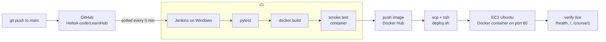

# Deploying LearnHub to AWS EC2 with Jenkins

This guide sets up the full CI/CD pipeline: every commit to `main` is tested, built into a Docker image, pushed to Docker Hub and deployed to an EC2 instance, then checked on the live site.



| Piece | What it is |
|---|---|
| `Jenkinsfile` | Pipeline: tests, image build, container smoke test, Docker Hub push, EC2 deploy, live check |
| `deploy/ec2-setup.sh` | One-time server setup: Docker, secret key, data volume, swap |
| `deploy/deploy.sh` | Runs on EC2: pulls an image tag, swaps the container, health-checks it, rolls back on failure |

**Time needed:** about 30–45 minutes the first time.
**Cost:** the instance types the console labels *Free tier eligible* (usually `t2.micro` or `t3.micro`) are covered by the AWS Free Tier or new-account credits; the exact offer depends on when your account was created, so check **Billing → Free Tier**. AWS also charges a small hourly fee for a public IPv4 address. Stop or terminate the instance when you don't need it (see [Clean up](#8-clean-up)).

---

## 1. Docker Hub

The pipeline pushes to `akhilhegde0118/online-education-platform` (set by `DOCKERHUB_REPO` in the `Jenkinsfile`).

1. Sign in at <https://hub.docker.com> with the account that owns that repository. To use your own account instead, change `DOCKERHUB_REPO` in the `Jenkinsfile` to `<your-username>/online-education-platform`.
2. **Repositories → Create repository**: name `online-education-platform`, visibility **Public** (EC2 pulls it without logging in).
3. **Account settings → Personal access tokens → Generate new token**: description `jenkins`, access **Read & Write**. Copy the token; it is shown once.

## 2. Launch the EC2 instance

In the AWS Console, pick a region close to your users (for example *Asia Pacific (Mumbai) ap-south-1*), then open **EC2 → Instances → Launch instances**:

| Setting | Value |
|---|---|
| Name | `learnhub` |
| AMI | **Ubuntu Server 24.04 LTS** (64-bit x86) |
| Instance type | `t2.micro` or `t3.micro` (whichever says *Free tier eligible*) |
| Key pair | **Create new key pair** → name `learnhub-key`, type RSA, format `.pem` → it downloads. Keep it safe. |
| Network settings → Firewall | **Create security group** `learnhub-sg` with: **SSH (22)** from *My IP* · **HTTP (80)** from *Anywhere (0.0.0.0/0)* |
| Storage | 16 GiB gp3 |
| Advanced details → User data | Paste the whole contents of [`deploy/ec2-setup.sh`](../deploy/ec2-setup.sh) |

Click **Launch instance**. After 2–3 minutes, open the instance and copy its **Public IPv4 address** (for example `13.233.10.20`).

> **SSH source:** "My IP" must include the machine that runs Jenkins. If Jenkins runs on your laptop, *My IP* covers it. If your IP changes (new Wi-Fi, mobile hotspot), update the SSH rule in the security group.
>
> **Optional – Elastic IP:** the public IP changes if you stop and start the instance. **EC2 → Elastic IPs → Allocate → Associate** with the instance keeps it fixed. Update the `ec2-host` credential if the IP ever changes.

### Check the server

From PowerShell on your computer (in the folder with the key):

```powershell
icacls .\learnhub-key.pem /inheritance:r /grant:r "$($env:USERNAME):R"
ssh -i .\learnhub-key.pem ubuntu@<PUBLIC_IP>
```

On the server:

```bash
docker --version                       # Docker is installed
sudo tail -5 /var/log/cloud-init-output.log   # ends with "Done. Docker … is ready."
ls -l /etc/learnhub/learnhub.env       # the secret key file exists
```

If the user-data script didn't run (for example you forgot to paste it), copy it over and run it by hand:

```bash
# on your computer
scp -i .\learnhub-key.pem deploy\ec2-setup.sh ubuntu@<PUBLIC_IP>:/tmp/
# on the server
sudo bash /tmp/ec2-setup.sh
```

Log out and back in once so the `ubuntu` user can run `docker` without `sudo`.

## 3. Prepare the Jenkins machine

Jenkins runs the pipeline with Windows `bat` and `powershell` steps, so it needs:

- **Python 3.10+** on `PATH` (already used by the test stages)
- **Docker Desktop**, running, and usable by the account the Jenkins service runs as. If `docker --version` works in a normal terminal but the pipeline fails with *permission denied* or *cannot connect to the Docker daemon*, open **Services → Jenkins → Log On** and run Jenkins as your own Windows user.
- **OpenSSH client** (built into Windows 10/11: `ssh -V` should print a version)

Plugins (**Manage Jenkins → Plugins**): *Pipeline*, *Git*, *Credentials Binding*, *SSH Credentials*, *JUnit*. They are part of the suggested plugins on a standard install.

## 4. Add the Jenkins credentials

**Manage Jenkins → Credentials → System → Global credentials → Add credentials**. The IDs must match exactly.

| ID | Kind | Values |
|---|---|---|
| `dockerhub-creds` | Username with password | Username: your Docker Hub username · Password: the access token from step 1 |
| `ec2-ssh-key` | SSH Username with private key | Username: `ubuntu` · Private key: *Enter directly* → paste the full contents of `learnhub-key.pem` |
| `ec2-host` | Secret text | Secret: the EC2 public IP or public DNS name (no `http://`) |

`dockerhub-creds` may already exist if the Docker Hub push stage has run before.

## 5. Create the pipeline job

1. **New Item** → name `learnhub` → **Pipeline** → OK.
2. **Pipeline → Definition:** *Pipeline script from SCM*
   - SCM: **Git**
   - Repository URL: `https://github.com/HelloA-code/LearnHub.git`
   - Branch specifier: `*/main`
   - Script path: `Jenkinsfile`
3. **Save → Build Now.**

The first build registers the job's settings: the `DEPLOY_TO_EC2` parameter and polling GitHub every 5 minutes for new commits. From the second build on, use **Build with Parameters** to run without deploying.

> **Webhook instead of polling:** if your Jenkins has a public URL, add a webhook in GitHub (**Settings → Webhooks → Add webhook**, payload URL `https://<jenkins>/github-webhook/`, content type `application/json`) and tick **GitHub hook trigger for GITScm polling** in the job. Jenkins on a laptop isn't reachable from GitHub, so polling is the default.

## 6. What a build does

| Stage | What happens | Fails when |
|---|---|---|
| Check Tools | Prints Python and Docker versions | Either is missing from `PATH` |
| Install Dependencies | `pip install` app and test requirements | A package can't be installed |
| Run Tests | `pytest` (23 tests); results appear under **Test Result** | Any test fails |
| Build Docker Image | Builds `online-education-platform:<build>` and `:latest` | The Dockerfile fails |
| Smoke Test Container | Runs the image on port 5055 and requests `/health`, `/`, `/course/1`, `/enroll/1`, `/my-enrollments`, `courses.json` | The container doesn't start or a page isn't 200 |
| Push to Docker Hub | Pushes `:<build>` and `:latest` | Wrong credentials or repository name |
| Deploy to EC2 | Copies `deploy/deploy.sh` to the server and runs it with the new tag | SSH fails, or the new container fails its health check (the previous version is restored automatically) |
| Verify Deployment | Requests `/health`, `/` and `/course/1` on `http://<ec2-host>` | The live site isn't reachable on port 80 |

When it's green, open **http://&lt;PUBLIC_IP&gt;/** in a browser.

## 7. Operating the server

**Logs and status**

```bash
docker ps                      # the learnhub container, up, port 80->5000
docker logs --tail 50 learnhub
curl -s localhost/health       # {"status":"healthy"}
```

**Roll back to an earlier build** (any tag on Docker Hub):

```bash
bash /tmp/learnhub-deploy.sh akhilhegde0118/online-education-platform:41
```

**Data.** The SQLite database lives in the Docker volume `learnhub-data` at `/data/learnhub.db` inside the container, so enrollments survive redeploys and reboots. To back it up:

```bash
docker run --rm -v learnhub-data:/data -v "$PWD":/backup alpine \
  cp /data/learnhub.db /backup/learnhub-$(date +%F).db
```

**Secret key.** `SECRET_KEY` is generated on the server in `/etc/learnhub/learnhub.env` and passed to the container with `--env-file`. It never goes through Git or Jenkins.

## 8. Clean up

To stop paying for the server when the project is finished: **EC2 → Instances → select `learnhub` → Instance state → Terminate**, then release any Elastic IP (**EC2 → Elastic IPs → Release**). Stopping (rather than terminating) stops the hourly instance charge but keeps the disk, which is still billed.

## Troubleshooting

| Symptom | Fix |
|---|---|
| `UNPROTECTED PRIVATE KEY FILE` or `Permission denied (publickey)` | Check the `ec2-ssh-key` credential has username `ubuntu` and the full `.pem` contents, including the `BEGIN`/`END` lines. The pipeline restricts the key file's permissions itself. |
| `Connection timed out` on port 22 | The security group's SSH rule doesn't include the Jenkins machine's current public IP. Edit `learnhub-sg` → SSH source → *My IP*. |
| `REMOTE HOST IDENTIFICATION HAS CHANGED` | A new instance reused an old IP. Remove the old entry: `ssh-keygen -R <PUBLIC_IP>`, run as the Jenkins service account (its file is `C:\Windows\System32\config\systemprofile\.ssh\known_hosts` when Jenkins runs as Local System). |
| `permission denied while trying to connect to the Docker daemon socket` on EC2 | The `ubuntu` user isn't in the `docker` group yet: run `sudo usermod -aG docker ubuntu`, or re-run `ec2-setup.sh`, then retry the build. |
| `denied: requested access to the resource is denied` when pushing | The Docker Hub token is read-only, or `DOCKERHUB_REPO` doesn't belong to the `dockerhub-creds` account. |
| Smoke test fails with *port is already allocated* | Something else uses port 5055 on the Jenkins machine. Change `SMOKE_PORT` in the `Jenkinsfile`. |
| Verify Deployment fails but Deploy passed | Port 80 isn't open to the internet: add **HTTP 80 from 0.0.0.0/0** to `learnhub-sg`. |
